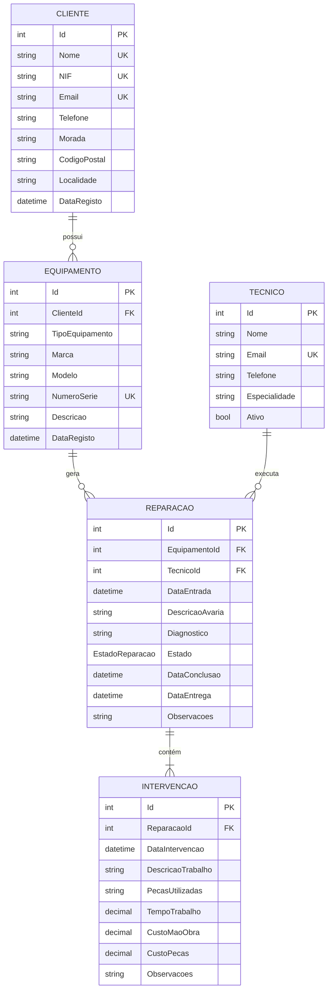

# 02 - Diagrama Entidade-Relação (Mermaid)

## Entidades e Cardinalidades

| Entidade | Cardinalidade | Descrição |
|----------|--------------|-----------|
| Cliente | 1:N com Equipamento | Um cliente pode ter vários equipamentos |
| Equipamento | N:1 com Cliente | Um equipamento pertence a um único cliente |
| Equipamento | 1:N com Reparação | Um equipamento pode ter várias reparações |
| Reparação | N:1 com Equipamento | Uma reparação diz respeito a um único equipamento |
| Tecnico | 1:N com Reparação | Um técnico pode executar várias reparações |
| Reparação | N:1 (opcional) com Tecnico | Uma reparação pode ter um técnico atribuído |
| Reparação | 1:N com Intervenção | Uma reparação pode ter várias intervenções |
| Intervenção | N:1 com Reparação | Uma intervenção pertence a uma única reparação |

## Regras de Integridade Referencial

- `ClienteId` em Equipamento → Chave estrangeira para Clientes (DELETE RESTRICT)
- `EquipamentoId` em Reparação → Chave estrangeira para Equipamentos (DELETE RESTRICT)
- `TecnicoId` em Reparação → Chave estrangeira para Tecnicos (DELETE SET NULL)
- `ReparacaoId` em Intervenção → Chave estrangeira para Reparacoes (DELETE RESTRICT)